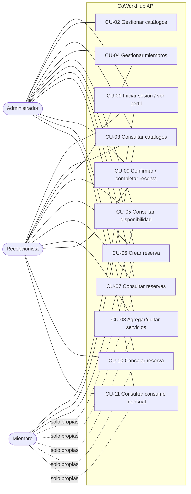
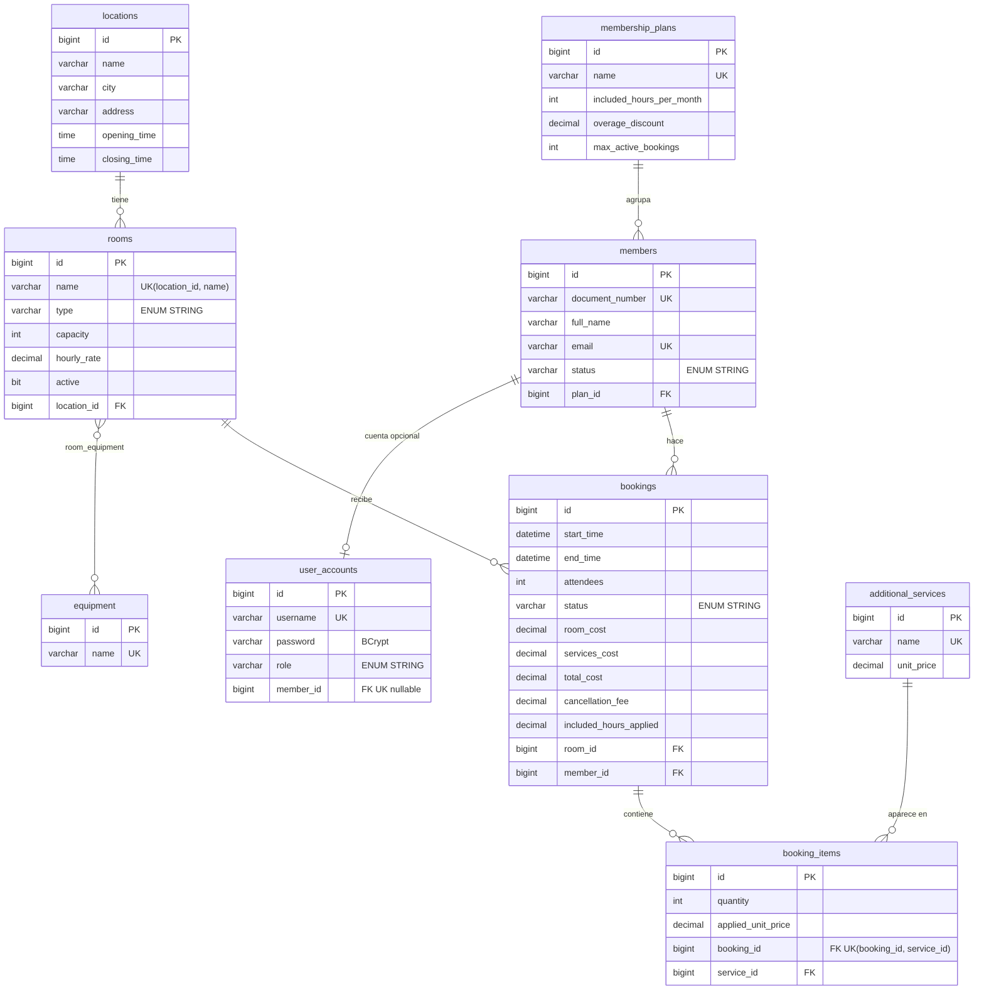

# CoWorkHub — Documento de análisis

Este documento describe **lo que está implementado** en el código. Cada decisión remite a la clase donde se aplica.

---

## 1. Actores y casos de uso

| Actor | Quién es | Cuenta |
|---|---|---|
| **Administrador** (`ADMIN`) | Responsable de la red de coworking | `user_accounts` sin miembro asociado |
| **Recepcionista** (`RECEPTIONIST`) | Personal de recepción de una sede | `user_accounts` sin miembro asociado |
| **Miembro** (`MEMBER`) | Cliente con un plan de membresía | `user_accounts` vinculada 1:1 a su `Member` |

| Caso de uso | Descripción | Actores |
|---|---|---|
| CU-01 Iniciar sesión / ver perfil | Envía usuario y contraseña, recibe un JWT de 60 min; consulta su usuario, rol y miembro | Todos |
| CU-02 Gestionar catálogos | Crea, modifica y elimina sedes, salas (con su equipamiento), equipamiento, servicios adicionales y planes | ADMIN |
| CU-03 Consultar catálogos | Lista y consulta los catálogos; filtra salas por sede | Todos |
| CU-04 Gestionar miembros | Registra miembros (con cuenta opcional), los actualiza, suspende, activa o elimina; filtra por nombre y estado | ADMIN, RECEPTIONIST (MEMBER solo ve su ficha) |
| CU-05 Consultar disponibilidad | Busca salas libres de una sede por fecha, franja, capacidad mínima y equipamiento | Todos |
| CU-06 Crear reserva | Reserva una sala con servicios opcionales; se calcula el costo | Personal para cualquier miembro; MEMBER a su nombre |
| CU-07 Consultar reservas | Lista con filtros (miembro, sala + fecha, estado) y consulta el detalle | Personal todas; MEMBER las suyas |
| CU-08 Agregar/quitar servicios | Modifica los servicios de una reserva `PENDING` y recalcula el costo | Personal; MEMBER en las suyas |
| CU-09 Confirmar / completar | Cambia el estado `PENDING→CONFIRMED` y `CONFIRMED→COMPLETED` | ADMIN, RECEPTIONIST |
| CU-10 Cancelar reserva | Cancela aplicando la política de cancelación | Personal; MEMBER las suyas |
| CU-11 Consultar consumo mensual | Horas incluidas usadas y disponibles, excedentes, costos y penalizaciones de un mes | Personal; MEMBER el suyo |

---

## 2. Glosario del dominio

| Término | Definición en CoWorkHub |
|---|---|
| **Reserva** (`Booking`) | Uso de una sala por un miembro en una franja `[inicio, fin)` del mismo día, de 30 min a 8 h en múltiplos de 30 min. Nace `PENDING` y puede pasar a `CONFIRMED`, `COMPLETED` o `CANCELLED` (RN-09). Guarda sus costos al momento de crearse. |
| **Plan** (`MembershipPlan`) | Condiciones comerciales del miembro: horas incluidas por mes, descuento sobre las horas excedentes y máximo de reservas activas futuras. |
| **Horas incluidas** | Horas de sala que el plan cubre sin costo cada mes calendario. Se consumen por orden de creación de las reservas y se registran en `Booking.includedHoursApplied`. |
| **Horas excedentes** | Horas de una reserva que superan las horas incluidas disponibles del mes. Se cobran a `tarifaHora × (1 − descuentoPlan)`. |
| **Solapamiento** | Dos reservas `PENDING`/`CONFIRMED` de la misma sala se solapan si `inicioA < finB` y `inicioB < finA`. Si una termina exactamente cuando empieza la otra **no** se solapan (RN-01). |
| **Cargo por cancelación** | Penalización al cancelar: 0 con 24 h o más de anticipación (y se devuelven las horas incluidas); 50 % del costo de sala entre 24 h y 2 h; con menos de 2 h o ya iniciada no se permite cancelar (RN-08). |

---

## 3. Modelo de dominio

**Tipos:** dinero en `BigDecimal` (`DECIMAL(12,2)`), fechas en `LocalDateTime`/`LocalTime`, enums con `@Enumerated(EnumType.STRING)` para que reordenar el enum no corrompa los datos.

### Justificación de cada relación

| Relación | Lado dueño (tiene la FK) | `fetch` | `cascade` / `orphanRemoval` | Por qué |
|---|---|---|---|---|
| `Location` 1→N `Room` | `Room.location` (`location_id`) | `LAZY` en ambos lados | Ninguno | La sala no existe sin sede, pero borrar una sede con salas está prohibido (RN-12): un `cascade REMOVE` lo contradiría. |
| `Room` N↔M `Equipment` | `Room.equipment` (`@JoinTable room_equipment`) | `LAZY` | Ninguno | Se edita desde la sala ("sala con su equipamiento"), por eso la sala es dueña. El equipamiento es un catálogo independiente: no se crea ni se borra en cascada. |
| `MembershipPlan` 1→N `Member` | `Member.plan` (`plan_id`) | `LAZY` | Ninguno | Un plan con miembros no se elimina (RN-12). |
| `Member` 1↔1 `UserAccount` (opcional) | `UserAccount.member` (`member_id UNIQUE NULL`) | `LAZY` en el dueño | Ninguno | La FK va en la cuenta porque ADMIN y RECEPTIONIST tienen cuenta sin miembro. El lado inverso `Member.userAccount` no se puede cargar en diferido en Hibernate, así que se incluye en los `@EntityGraph` de los listados para no generar N+1. |
| `Member` 1→N `Booking` | `Booking.member` (`member_id`) | `LAZY` | Ninguno | Las reservas son historial: un miembro con reservas no se elimina (RN-12). |
| `Room` 1→N `Booking` | `Booking.room` (`room_id`) | `LAZY` | Ninguno | Igual que la anterior. |
| `Booking` 1→N `BookingItem` | `BookingItem.booking` (`booking_id`) | `LAZY` | `CascadeType.ALL` + `orphanRemoval = true` | El ítem es parte de la reserva (composición): se guarda con ella y quitarlo de la lista lo borra de la base (`DELETE /api/reservas/{id}/servicios/{servicioId}`). |
| `AdditionalService` 1→N `BookingItem` | `BookingItem.service` (`service_id`) | `LAZY` | Ninguno | El servicio es catálogo; usado en reservas no se elimina (RN-12). `appliedUnitPrice` congela el precio. |

**Sin N+1 ni referencias circulares:** `spring.jpa.open-in-view=false`, todas las asociaciones `LAZY`, y cada listado usa `@EntityGraph` o `join fetch` (`BookingRepository`, `RoomRepository`, `MemberRepository`). Verificado con `show-sql=true`: `GET /api/reservas` emite una sola consulta de datos. Los controladores solo devuelven DTO (`record`), así que nunca se serializa una entidad.

---

## 4. Matriz de trazabilidad

| RF | Descripción | Reglas | Endpoints | Implementación |
|---|---|---|---|---|
| RF-01 | Gestionar catálogos | RN-11, RN-12, RN-13 | `GET/POST /api/{sedes,salas,equipamientos,servicios-adicionales,planes}`, `GET/PUT/DELETE …/{id}` | `LocationService`, `RoomService`, `EquipmentService`, `AdditionalServiceCatalogService`, `MembershipPlanService` |
| RF-02 | Gestionar miembros | RN-11, RN-12, RN-13 | `GET/POST /api/miembros`, `GET/PUT/DELETE /api/miembros/{id}`, `PATCH …/suspender`, `PATCH …/activar` | `MemberService` |
| RF-03 | Consultar disponibilidad | RN-01, RN-03, RN-04 | `GET /api/disponibilidad` | `AvailabilityService` |
| RF-04 | Crear reserva | RN-01 a RN-07, RN-13 | `POST /api/reservas` | `BookingServiceImpl.create`, `BookingRules`, `CostCalculator` |
| RF-05 | Consultar reservas | RN-13 | `GET /api/reservas`, `GET /api/reservas/{id}` | `BookingServiceImpl.findAll/findById` |
| RF-06 | Agregar/quitar servicios | RN-07, RN-10, RN-13 | `POST /api/reservas/{id}/servicios`, `DELETE /api/reservas/{id}/servicios/{servicioId}` | `BookingServiceImpl.addService/removeService` |
| RF-07 | Confirmar reserva | RN-09, RN-13 | `POST /api/reservas/{id}/confirmar` | `BookingServiceImpl.confirm` |
| RF-08 | Cancelar reserva | RN-08, RN-09, RN-13 | `POST /api/reservas/{id}/cancelar` | `BookingServiceImpl.cancel`, `CancellationPolicy` |
| RF-09 | Completar reserva | RN-09, RN-13 | `POST /api/reservas/{id}/completar` | `BookingServiceImpl.complete` |
| RF-10 | Consumo mensual | RN-07, RN-08, RN-13 | `GET /api/miembros/{id}/consumo?mes=yyyy-MM` | `MemberServiceImpl.getMonthlyConsumption` |
| RF-11 | Iniciar sesión | RN-13 | `POST /auth/login` | `AuthServiceImpl.login`, `JwtService` |
| RF-12 | Proteger por rol y dueño | RN-13 | Todos salvo los públicos | `SecurityConfig`, `@PreAuthorize`, `CurrentUserProvider` |
| RF-13 | Documentar la API | — | `/doc/swagger-ui.html`, `/v3/api-docs` | `OpenApiConfig`, `docs/openapi.json` |
| RF-14 | Perfil del usuario | RN-13 | `GET /auth/perfil` | `AuthServiceImpl.profile` |
| RF-15 | Salud del servicio | — | `GET /actuator/health` | Spring Boot Actuator |

**Cada regla aparece en al menos un RF:** RN-01 (RF-03, RF-04), RN-02 a RN-06 (RF-04), RN-07 (RF-04, RF-06, RF-10), RN-08 (RF-08, RF-10), RN-09 (RF-07 a RF-09), RN-10 (RF-06), RN-11 y RN-12 (RF-01, RF-02), RN-13 (todos los protegidos).

---

## 5. Supuestos y decisiones

| # | Ambigüedad | Decisión tomada |
|---|---|---|
| S-01 | ¿Cómo saber cuántas horas incluidas quedan en el mes? | Se agrega `Booking.includedHoursApplied`. Horas disponibles = horas del plan − Σ `includedHoursApplied` de las reservas del mes de inicio. Las horas se asignan en el orden en que se crean las reservas. |
| S-02 | ¿Qué pasa con las horas al cancelar tarde (entre 24 h y 2 h)? | **No** se devuelven: se cobra el 50 % del costo de sala y las horas incluidas usadas siguen consumidas. Solo la cancelación con 24 h o más pone `includedHoursApplied = 0`. |
| S-03 | Si la reserva estaba cubierta por horas incluidas (costo de sala 0), ¿cuánto se cobra al cancelar tarde? | 50 % de 0 = 0, pero las horas incluidas se pierden (S-02). |
| S-04 | Límites exactos de RN-08 | Exactamente 24 h → gratis. Exactamente 2 h → se permite con 50 %. Menos de 2 h o ya iniciada → `409`. |
| S-05 | Límite de RN-03 | Exactamente 1 h de anticipación se acepta; 59 min se rechaza. |
| S-06 | RN-02 "en intervalos de 30 minutos" | Se exige que la duración sea múltiplo de 30 min; no se exige que el inicio caiga en :00 o :30. |
| S-07 | Zona horaria | Todas las reglas usan el reloj `businessClock` (America/Bogota). Los instantes del JWT usan el reloj UTC. |
| S-08 | Concurrencia (RN-01, RN-06) | Al crear una reserva se bloquean con `SELECT … FOR UPDATE` el miembro y luego la sala, en transacción `READ_COMMITTED`. La segunda solicitud simultánea espera y recibe `409 RN-01`. |
| S-09 | Agregar un servicio que la reserva ya tiene | Se suma la cantidad al ítem existente y se conserva el precio aplicado original (hay un único ítem por servicio y reserva). |
| S-10 | Quitar un servicio que la reserva no tiene | `404`. |
| S-11 | RN-12 con historial | Una sala o un miembro con **cualquier** reserva (incluso solo historial) no se elimina, para no perder la trazabilidad de cobros. Para retirar una sala se marca `activa = false`; para un miembro, `suspender`. |
| S-12 | Eliminar un miembro con cuenta | Si no tiene reservas, se elimina junto con su cuenta de usuario (la cuenta es parte del registro del miembro). |
| S-13 | Listado de reservas | Los filtros son opcionales y combinables. Un MEMBER siempre ve solo las suyas; si envía el `miembroId` de otro → `403`. |
| S-14 | Completar una reserva | Solo se valida la transición `CONFIRMED → COMPLETED`; no se exige que la hora de fin haya pasado. |
| S-15 | DELETE exitoso | Responde `204 No Content`. |
| S-16 | RN-11 correo | El correo se guarda en minúsculas y la unicidad no distingue mayúsculas. |
| S-17 | Personal sin `miembroId` al reservar | `400`: ADMIN y RECEPTIONIST deben indicar a nombre de quién reservan. |

---

## 6. Fuera de alcance

- Pagos en línea y facturación fiscal (solo se calculan montos).
- Notificaciones por correo.
- Frameworks de frontend (React, Angular, etc.) e instalación con npm: el frontend incluido es HTML, CSS y JavaScript puro, servido por el mismo backend desde `src/main/resources/static/`.
- Gestión por API de las cuentas del personal (ADMIN y RECEPTIONIST vienen en `import.sql`).
- Recuperación de contraseña y *refresh tokens*.
- Cambio de contraseña y gestión de la cuenta por el propio miembro.
- Reprogramar una reserva (cambiar sala u horario): se cancela y se crea otra.
- Paginación de listados.

---

## 7. Cobertura de módulos del curso

| Módulo | Dónde se aplica |
|---|---|
| 01 Introducción a Spring Boot | `CoworkhubApplication`, paquetes por capa, DTO como `record`, `Optional` en repositorios, streams en `CostCalculator` y `MemberServiceImpl.getMonthlyConsumption`, Actuator |
| 02 Dependencias y Java Beans | Servicios interfaz + `impl`; `BeansConfig` (`@Configuration`, `@Bean` `Clock` y `PasswordEncoder`, `@Primary` y `@Qualifier("utcClock")`); `AppProperties` (`@Value`, `@PostConstruct`); `CostCalculator` `@Component` |
| 03 Introducción a JPA | 9 entidades y repositorios; consultas derivadas (`existsBy…`); JPQL para solapamientos (`findRoomBookingsInRange`) y disponibilidad (`findBusyRoomIds`); `ddl-auto=create` para ejecutar `import.sql` |
| 04 Gestión de BD con JPA | `@OneToOne`, `@OneToMany`/`@ManyToOne`, `@ManyToMany` + `@JoinTable`, `cascade` + `orphanRemoval`, `import.sql` |
| 05 Diseño de API REST | `presentation/*Controller`, `ResponseEntity.created` (201), `@PathVariable`, `@RequestParam`, Bean Validation y validadores propios (`validation/`) |
| 06 Swagger | `OpenApiConfig`, `@Tag`, `@Operation`, `@ApiResponse`, `@Schema`, `docs/openapi.json` |
| 07 Manejo de excepciones | `exception/` (`BusinessRuleException`, `ResourceNotFoundException`…), `GlobalExceptionHandler` (`@RestControllerAdvice`), `ErrorResponse` |
| 08 Spring Security y JWT | `SecurityConfig`, `JwtService`, `JwtAuthenticationFilter`, `UserAccountDetailsService`, BCrypt, `@PreAuthorize`, `RestAuthenticationEntryPoint` (401) y `RestAccessDeniedHandler` (403) |
